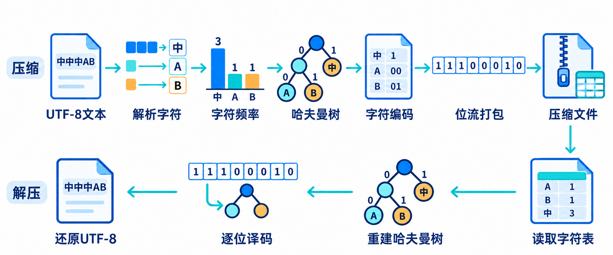
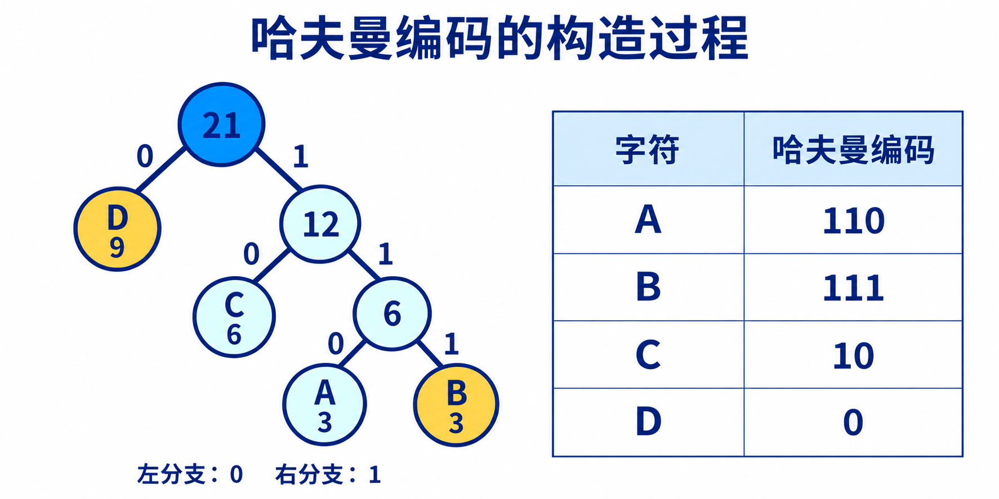

# 基于哈夫曼编码的无损文件压缩与还原

数据结构课程的C++17教学项目，以ASCII文本为基础对象。按字节统计频率，构造哈夫曼树，实现位流打包、文件压缩、解压及逐字节验证，并计算WPL、平均码长和信息熵。

仓库：[810238492/huffman-ascii](https://github.com/810238492/huffman-ascii)。配有8课时实验指导书、四类测试文件及离线动态网页。

## 项目结构

```text
huffman-ascii/
├── README.md
├── code/
│   ├── huffman_ascii.cpp       # 完整参考实现
│   ├── samples/demo.txt       # A3、B3、C6、D9，无末尾换行
│   ├── samples/demo_codes.txt # 编码表与指标
│   ├── testdata/              # 四类原始测试文件及说明
│   └── tests/
│       ├── test_ascii.py      # 参考编码、往返、指标和异常验证
│       └── core_checks.cpp    # 树、同权规则、文件头及64位权值
└── docs/
    ├── 实验指导书.md
    ├── 实验指导书.docx
    ├── huffman-tree.html      # 离线构树演示
    └── images/                # 压缩还原与文件格式配图
```

## 功能与范围

- 支持码值0—127，每个字符在文件中存为1字节；固定数组freq[128]统计频次。
- 二进制读写，保留空格、标点、TAB、CR/LF、NUL等ASCII字节，不转换换行。
- 显示码值、字符标签、频次、编码、码长及指标；显示压缩率和处理耗时。
- 处理空文件、单一字符文件及损坏文件；不覆盖已有输出。
- 输入含128及以上字节（例如含汉字或BOM）时提示错误。中文及空格**文件路径**可使用。

ASCII采用7位码值，本实验文件每个字符占1字节。中文提示和源码注释使用UTF-8，不代表数据输入支持非ASCII文本。

## 编译与运行

在code目录执行，需要支持C++17的编译器。

Windows MinGW：

```powershell
g++ -std=c++17 -O2 -Wall -Wextra -finput-charset=UTF-8 -fexec-charset=UTF-8 huffman_ascii.cpp -o huffman_ascii.exe -lshell32
.\huffman_ascii.exe
```

Linux：

```bash
g++ -std=c++17 -O2 -Wall -Wextra huffman_ascii.cpp -o huffman_ascii
./huffman_ascii
```

可使用Dev-C++、Code::Blocks或已配置编译器和调试器的VS Code，标准设为C++17。Windows的shell32用于正确读取含中文的命令行路径。

| 命令 | 功能 | 参数 |
|---|---|---|
| c | 压缩 | 原文件、压缩文件 |
| d | 解压 | 压缩文件、还原文件 |
| v | 比较长度与全部字节 | 原文件、还原文件 |
| t | 查看频率、编码与指标 | 原文件 |
| --help | 帮助 | 无 |

```powershell
.\huffman_ascii.exe t samples\demo.txt
.\huffman_ascii.exe c samples\demo.txt demo.huf
.\huffman_ascii.exe d demo.huf restored.txt
.\huffman_ascii.exe v samples\demo.txt restored.txt
```

不带参数进入菜单：1压缩、2解压、3比较文件、4查看编码与指标、0退出。输出使用新文件名。成功返回0，失败或比较不一致返回1，参数错误返回2。

## 算法与文件格式



1. 首次扫描文件，用固定数组统计频次，按ASCII码值升序建立字符表。
2. 使用从1开始的HTNode数组、双亲及孩子下标构树。每次选两个最小权值结点，同权时优先选编号较小者，先选者为左孩子，新结点依次编号。
3. 左0右1，从叶结点回溯并逆序生成编码。再次扫描原文，将编码位打包保存。
4. 解压读取频率表，按相同规则重建树，逐位沿树译码，达到原始字符总数后结束。

核心采用结构体、动态数组、引用和独立函数，便于课程阅读。原文无需全部装入内存；顺序扫描构树时间为O(n²)，n最多128，最多255个树结点。


| 字段 | 长度 | 含义 |
|---|---:|---|
| 原始字符总数N | 8字节 | 无符号64位，等于原文件字节数 |
| 字符种类数n | 4字节 | 无符号32位，范围0—128 |
| 非零频率表 | 5n字节 | 1字节ASCII码值＋4字节频次，按码值升序 |
| 编码数据区 | 可变 | 按高位到低位打包，末尾低位补零 |

所有整数采用小端序，数据区偏移为12＋5n。文件头保存频率表，不保存树或编码表。固定数组用于统计，文件仅保存实际出现的非零项。

- 空文件的压缩文件12字节，还原后仍为零字节。
- 单一字符编码0，实际平均码长1；根深度为零，WPL为0，信息熵为0。
- 频次为32位无符号整数，树权值、WPL和编码位数为64位无符号整数。
- 格式无魔数、版本号及校验和，与早先UTF-8字符格式不兼容。检查频率、截断、多余数据及补零，最终以v命令验证；这些检查不能检测所有内容篡改。

## 示例与指标



demo.txt含3个A、3个B、6个C、9个D，共21字节，编码分别为110、111、10、0。WPL为39，平均码长约1.857143 bit/字符，信息熵约1.842371 bit/字符；编码数据39位，完整压缩文件37字节。

WPL按叶频次乘深度累加；平均码长按频次乘实际码长累加后除以N；信息熵按经验概率计算。多字符样本平均码长等于WPL/N，并处于信息熵至信息熵加一之间。

压缩率＝完整压缩文件字节数÷原文件字节数×100%。越小越好，大于100%表示变大；空文件不计算压缩率、平均码长和信息熵。文件头及补零计入实际文件大小，不计入平均码长。

## 四类教学测试

| 文件 | 原始字节数 | 字符种类 | 压缩字节数 | WPL | 平均码长 | 信息熵 |
|---|---:|---:|---:|---:|---:|---:|
| 01_ASCII混合文本.txt | 39680 | 44 | 24328 | 192768 | 4.858065 | 4.833802 |
| 02_空文件.txt | 0 | 0 | 12 | 0 | — | — |
| 03_单一字符.txt | 1024 | 1 | 145 | 0 | 1 | 0 |
| 04_字符分布均匀.txt | 6080 | 95 | 5543 | 40448 | 6.652632 | 6.569856 |

四类文件的程序输出已与独立参考编码及还原字节核对。输入文件位于code/testdata，精确指标见其中说明。

## 自动验证

先编译主程序，在code目录用Python3运行：

```powershell
python tests/test_ascii.py
g++ -std=c++17 -O2 tests/core_checks.cpp -o tests/core_checks.exe -lshell32
.\tests\core_checks.exe
```

Linux核心检查去掉-lshell32，使用无.exe后缀的编译产物。

覆盖38组文件往返、全部128种ASCII码值、独立参考压缩字节及指标、6组非ASCII输入、48组损坏文件、中文空格路径、菜单和已有输出保护。核心检查覆盖同权规则、文件头、单一字符及64位权值。报告位于tmp/ascii_huffman_tests；不提交编译产物及临时测试文件。

## 课前导学

下载docs/huffman-tree.html后可离线打开。网页借助AI制作，用于观察构树编码。课程内结合学习通AI助学智能体答疑、理论测试及反馈补学，测试达到80分及以上后进入实验。完整安排见[实验指导书](docs/实验指导书.md)。
